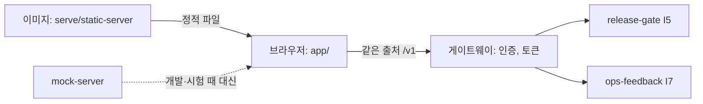

# admin-console (운영 콘솔)

사람이 직접 쓰는 내부 운영 화면이다. 지금은 두 화면이 있다. 출고 승인과 실패 사례 검토.

이 앱은 웹 브라우저에서 여는 정적 웹 앱(TypeScript, 프레임워크 없음)이다. AI 학습 담당자가 새 모델 릴리스의 평가 보고서를 읽고 승인 또는 반려한다(출고 승인). 또 운영 중 모인 실패 사례(환자 발화는 비식별된 것)를 보고 정답을 확정하거나 기각한다(실패 사례 검토). 환자용 화면이 아니다(환자용은 `kiosk-frontend`). 하지 않는 것: 승인 판단(사람이 한다. 화면은 합격/불합격을 판정하지 않는다), 지표 계산, 릴리스 활성화·롤백 화면, 서버 토큰 보관, 데이터 저장(소유 저장소 없음). (docs/brief.md, docs/boundary.md)

## 1. 전체 속의 위치

| 방향 | 이웃 | 인터페이스 | 내용 |
| --- | --- | --- | --- |
| 입력 | release-gate | I5 GateService: `GET /v1/submissions`, `GET /v1/submissions/{id}`, `GET /v1/submissions/{id}/review-report` | 승인 대기 제출 목록, 승인 요청 보고서(`ReviewReport`) |
| 입력 | ops-feedback | I7 FailureStore: `GET /v1/cases`, `GET /v1/cases/{id}`, `GET /v1/deidentified-traces/{ref}` | 실패 사례, 비식별 trace |
| 출력 | release-gate | I5: `POST /v1/approvals` | 승인/반려 결정(`report_hash` 포함) |
| 출력 | ops-feedback | I7: `POST /v1/cases/{id}/review` | 검토 결과(확정/기각/대기) |
| 중계 | deploy 게이트웨이 | 같은 출처의 `/v1` | 사람 인증, 토큰, `X-Openit-User` 부착. 이 이미지는 `/v1`을 프록시하지 않는다 |

콘솔이 멈춰도 문진 서비스와 게이트의 자동 검사는 영향이 없다. 출고 승인만 막힌다(게이트 API로 직접 승인은 가능). (docs/boundary.md)

## 2. 구조

| 경로 | 역할 |
| --- | --- |
| `app/` | 화면. 상태(model), 컨트롤러, 뷰, `index.html`, CSS. 승인 화면과 `cases-*`(실패 사례 검토) |
| `api/` | I5/I7 HTTP 클라이언트와 타입. UI와 무관 |
| `mock-server/` | 모의 게이트(I5)와 모의 FailureStore(I7). 시나리오는 제출·사례 ID로 고른다 |
| `serve/static-server.mjs` | 이미지에서 쓰는 정적 서버(`/healthz`, `/readyz`, `/config.json`) |
| `scripts/` | `build.mjs`(esbuild), `gen-schemas.mjs`(문진 스키마 검증기 생성), `smoke.sh`(이미지 스모크) |
| `generated/` | 생성된 문진 스키마 검증기(커밋됨. 정책은 CR-003에서 헤드 결정 대기) |
| `tests/` | `node:test` 시험(jsdom 포함) |
| `Dockerfile` | 다단계 빌드, non-root(`node`), 포트 8080 |
| `docs/` | 아래 7절 |



승인 흐름: 목록 → 보고서(SAFETY 지표 맨 위) → 승인/반려 → 확인창 → 전송. 보고서 해시는 계산하지 않고 응답 헤더 `X-Openit-Report-Hash`를 그대로 돌려보낸다. 409 `STALE_REPORT`이면 보고서를 다시 불러온다. (docs/design.md 1, 3절)

## 3. 실행 방법

전제: Node 24 이상(`package.json` engines). 이미지 스모크에는 Docker와 curl이 필요하다. Python은 쓰지 않는다. 이 영역에는 비밀 값이 없다. 토큰은 코드·빌드·브라우저에 없고 게이트웨이가 붙이므로 `NAME_FILE`(D84) 방식으로 받을 비밀이 없다. 설정은 환경 변수(`PORT`, `STATIC_DIR`, 개발용 `ADMIN_DEV_APPROVER_ID`)로만 받는다.

```bash
cd admin-console
npm ci                # 설치(잠금 파일 기준)
npm run typecheck     # 타입 검사
npm test              # 시험
npm run build         # dist/ 생성
npm run mock          # 모의 서버(개발용)
npm start             # 정적 서버(PORT 기본 8080)
npm run smoke         # 이미지 빌드 + 실행 + /healthz 등 확인(Docker 필요, 포트는 Docker가 배정)
```

이 세션에서 돌려 본 것: `npm run typecheck`(오류 없음), `npm test`(아래 4절).
돌리지 않은 것: `npm ci`(`node_modules`가 이미 있어 그대로 씀), `npm run build`, `npm run mock`, `npm start`, `npm run smoke`(이미지 빌드).

## 4. 현재 상태

확인된 것
- docs/STATUS.md 기준: 작업 단위 1 시험 25개, 작업 단위 2 포함 총 42개, 타입 검사, 이미지·스모크(`npm run smoke`)가 통과한 것으로 기록되어 있다. 스모크는 이 세션에서 다시 돌리지 않았다.
- 이 세션(`npm test`): 42개 중 40 통과, 2 실패. 타입 검사는 통과.
  - `generated/survey-validators.cjs가 원본 스키마와 같다`: `../survey-service/schema/schemas/UtteranceParserInput.json`이 없어서 실패. 현재 작업 사본에는 그 파일이 없다.
  - `모의 FailureStore 출력이 FailureCase 스키마를 통과한다`: 모의 서버의 `expected_kind`(PARSER|GENERATOR)가 현재 `boundary-contracts` 작업 사본(`v2.0.2` 이후)의 열거(`LORA_A`, `LORA_B`)와 다르다.
  - 원인 추정(미확인): 문서는 `boundary-contracts v1.3.3`과 문진 스키마 v1 입출력 4종을 기준으로 쓰였고, 이웃은 그 뒤 v2.0.2로 올라갔다(G11, 헤드 STATUS). Dockerfile 라벨도 `v1.3.3`이다.

확인 못 한 것: 실제 release-gate·ops-feedback과의 연동, 실제 브라우저(레이아웃, 접근성, 키보드, CSP 아래 번들 실행), CI 이미지 빌드와 digest 게시(D24). 이상은 docs/STATUS.md의 "남은 일".

## 5. 이 영역의 열린 항목

`head/docs/OPEN_GAPS.md`에서 이 영역을 직접 가리키는 항목은 다음 하나다. 나머지(G/U/H)는 다른 영역이다.

| ID | 요약 | 막고 있는 것 |
| --- | --- | --- |
| D-A | 운영 도메인·HTTPS, 직원 콘솔 로그인 등 | 사용자 결정(열림). 사람 인증이 정해져야 게이트웨이 구성과 이 콘솔의 운영 접속이 정해진다 |

대장에는 없지만 이 영역 문서에 열려 있는 것(확인 대상): CR-002(게이트웨이 경로, 헤드가 deploy에 전달 중), CR-003(검토자 기록 위치, 생성물 커밋 정책, 게이트웨이 경로, 헤드 결정 대기), 위 4절의 시험 2건(계약 v2 반영 필요, 대장에 ID 없음).

## 6. 더 자세한 문서

| 문서 | 내용 |
| --- | --- |
| `CLAUDE.md` | 이 영역 에이전트의 지침 |
| `docs/brief.md` | 목적, 소유·소비 계약, 수용 기준, 경계 |
| `docs/design.md` | 화면 흐름, HTTP 대응표, 해시와 409, 모의 시나리오, 기술 선택 |
| `docs/boundary.md` | 소유 저장소, 소비 계약과 버전, 장애 영향 |
| `docs/STATUS.md` | 한 일, 남은 일, 막힌 것 |
| `docs/change-requests/` | CR-001(해결), CR-002, CR-003 |

런북(`docs/runbook.md`)은 이 리포에 없다(CLAUDE.md는 런북을 두라고 하지만 아직 쓰이지 않았다).
