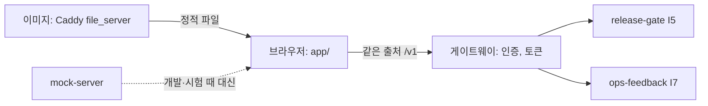

# admin-console (운영 콘솔)

사람이 직접 쓰는 내부 운영 화면이다. 지금은 세 화면이 있다. 출고 승인, 실패 사례 검토, 릴리스 운영(활성화·롤백, D85).

이 앱은 웹 브라우저에서 여는 정적 웹 앱(TypeScript, 프레임워크 없음)이다. AI 학습 담당자가 새 모델 릴리스의 평가 보고서를 읽고 승인 또는 반려한다(출고 승인). 또 운영 중 모인 실패 사례(환자 발화는 비식별된 것)를 보고 정답을 확정하거나 기각한다(실패 사례 검토). 환자용 화면이 아니다(환자용은 `kiosk-frontend`). 하지 않는 것: 승인 판단(사람이 한다. 화면은 합격/불합격을 판정하지 않는다), 지표 계산, 서버 토큰 보관, 데이터 저장(소유 저장소 없음). (docs/brief.md, docs/boundary.md)

## 1. 전체 속의 위치

| 방향 | 이웃 | 인터페이스 | 내용 |
| --- | --- | --- | --- |
| 입력 | release-gate | I5 GateService: `GET /v1/submissions`, `GET /v1/submissions/{id}`, `GET /v1/submissions/{id}/review-report` | 승인 대기 제출 목록, 승인 요청 보고서(`ReviewReport`) |
| 입력 | ops-feedback | I7 FailureStore: `GET /v1/cases`, `GET /v1/cases/{id}`, `GET /v1/deidentified-traces/{ref}` | 실패 사례, 비식별 trace |
| 출력 | release-gate | I5: `POST /v1/approvals` | 승인/반려 결정(`report_hash` 포함) |
| 입력 | release-gate | I4: `GET /v1/active-pointer`, `GET /v1/releases` | 현재 활성 포인터, 릴리스 목록(이력) |
| 출력 | release-gate | I5: `POST /v1/activate`, `POST /v1/rollback` | 릴리스 활성화, 롤백 요청(operator 역할만. 본문에 `requested_by_role: operator`를 계약대로 보내고, 행위자는 서버가 `X-Openit-User`로 기록한다. 본문에 이름은 보내지 않는다) |
| 출력 | ops-feedback | I7: `POST /v1/cases/{id}/review` | 검토 결과(확정/기각/대기) |
| 중계 | deploy 게이트웨이 | 같은 출처의 `/v1` | 사람 인증, 토큰, `X-Openit-User` 부착. 이 이미지는 `/v1`을 프록시하지 않는다 |

콘솔이 멈춰도 문진 서비스와 게이트의 자동 검사는 영향이 없다. 출고 승인만 막힌다(게이트 API로 직접 승인은 가능). (docs/boundary.md)

## 2. 구조

| 경로 | 역할 |
| --- | --- |
| `app/` | 화면. 상태(model), 컨트롤러, 뷰, `index.html`, CSS. 승인 화면, `cases-*`(실패 사례 검토), `ops-*`(릴리스 운영, `#/ops`) |
| `api/` | I5/I7 HTTP 클라이언트와 타입. UI와 무관 |
| `mock-server/` | 모의 게이트(I5), 모의 릴리스 운영(`releases.ts`: 활성 포인터·목록·activate·rollback, operator 아니면 403)와 모의 FailureStore(I7). 시나리오는 제출·사례 ID로 고른다 |
| `scripts/build-image.sh` | 영역 빌드 진입점(계약 BuildImageRequest/Result, ADR 0019). 스모크도 이것으로 빌드한다 |
| `deploy-exposure.json` | 게이트웨이 노출 선언의 정본(계약 Exposure). 빌드 진입점이 라벨 `io.openit.exposure`로 단다(ADR 0021) |
| `serve/Caddyfile` | 이미지의 Caddy file_server 설정(`/healthz`, `/readyz`, 보안 헤더, ADR 0018) |
| `scripts/` | `build.mjs`(esbuild), `gen-schemas.mjs`(계약 패키지 스키마 검증기 생성), `smoke.sh`(이미지 스모크) |
| `generated/` | 생성된 계약 스키마 검증기(ActionExtraction 계열, 경계 형식 5종, ImageLabels)와 계약 버전 상수(커밋됨, ADR 0017. 정책은 CR-003에서 헤드 결정 대기) |
| `tests/` | `node:test` 시험(jsdom 포함) |
| `Dockerfile` | 다단계 빌드, non-root(`node`), 포트 8080 |
| `docs/` | 아래 7절 |



릴리스 운영(`#/ops`): 현재 활성 릴리스(ID, 활성화 시각, 포인터 버전), 활성화할 수 있는 새 릴리스와 '활성화…'(확인 단계에서 실행, ID 입력 없음), '이전 릴리스로 롤백…'(대상 표시, 사유·근거 ID 필수), 영수증, 릴리스 이력. 오류는 403(operator 아님), 409(경쟁), 412(PASS 아님), 네트워크로 구분해 보인다. 활성화한 사람과 포인터 변경 이력은 계약에 없어 보이지 못한다(CR-004).

승인 흐름: 목록 → 보고서(SAFETY 지표 맨 위) → 승인/반려 → 확인창(제출 ID를 입력해야 확정, ADR 0014) → 전송. 보고서 해시는 계산하지 않고 응답 헤더 `X-Openit-Report-Hash`를 그대로 돌려보낸다. 409 `STALE_REPORT`이면 보고서를 다시 불러온다. (docs/design.md 1, 3절)

## 3. 실행 방법

전제: Node 24 이상(`package.json` engines). 이미지 스모크에는 Docker와 curl이 필요하다. Python은 쓰지 않는다. 이 영역에는 비밀 값이 없다. 토큰은 코드·빌드·브라우저에 없고 게이트웨이가 붙이므로 `NAME_FILE`(D84) 방식으로 받을 비밀이 없다. 

```bash
bash scripts/setup-env.sh   # 환경 준비의 정본: node 버전 확인 + npm ci(잠금 파일 기준, 이미 준비됐으면 생략). 표준 출력 마지막 줄에 SetupEnvReport JSON(ADR 0020)
npm run typecheck     # 타입 검사
npm test              # 시험
npm run build         # dist/ 생성
npm run mock          # 모의 서버(개발용)
npm run smoke         # 이미지 빌드 + 실행 + /healthz 등 확인(Docker 필요, 포트는 Docker가 배정)
```

`node scripts/gen-schemas.mjs [--check]`는 이웃 `boundary-contracts/schemas`(읽기 전용)가 있어야 돈다. 없으면 `boundary-contracts/schemas를 찾을 수 없다`를 내고 종료 코드 2로 끝난다. `setup-env.sh`, typecheck, build에는 이웃 폴더가 필요 없다. 그러나 `npm test`의 일부(`mock-conformance`, `ops-conformance`, `v2-report-ui`의 공식 예시 1건)는 이웃 `boundary-contracts`의 스키마·예시를 직접 읽어, 이웃 폴더가 없는 새 clone에서는 실패한다(2026-10-28 확인: 74개 중 통과 70, 실패 3, 건너뜀 1; 실패 2건은 파일 단위로 불러오지 못함). 시험과 생성기는 이웃의 작업 트리가 아니라 **Dockerfile ARG가 고정한 태그의 내용**(`git show <태그>:<경로>`, `scripts/contract-src.mjs`)을 읽으므로, 이웃이 고정 태그보다 앞서 있어도 결과가 같다. 시험을 돌리려면 이 리포 옆에 그 태그를 가진 `boundary-contracts` 리포가 있어야 한다(없으면 일부 시험은 건너뛰고 일부는 실패한다). 이웃이 없을 때 건너뛰게 바꾸는 것은 아직 하지 않았다.

이 세션에서 돌려 본 것: `npm run typecheck`(오류 없음), `npm test`(아래 4절).
돌리지 않은 것: `npm run build`, `npm run mock`, `npm start`, `npm run smoke`(이미지 빌드).

## 4. 현재 상태

확인된 것
- docs/STATUS.md 기준: 작업 단위 1 시험 25개, 작업 단위 2 포함 총 42개, 타입 검사, 이미지·스모크(`npm run smoke`)가 통과한 것으로 기록되어 있다. 스모크는 이 세션에서 다시 돌리지 않았다.
- `npm test` 156개 중 149개 통과, 실패 0, 건너뜀 7(정적 서버 동작 시험은 `npm run smoke`가 이미지에 대해 돌린다; 2026-10-30 실행, 이 PC 한 환경, wo-300 워크트리), `npm run typecheck` 통과, `npm run smoke` 통과(2026-10-29, 라벨 contracts.boundary=v3.0.0). 이전에 실패하던 2건의 원인과 수정은 docs/STATUS.md 작업 단위 3.
- 계약 기준은 boundary-contracts 태그다. 정본은 Dockerfile의 ARG이고, 생성 검증기 헤더는 `scripts/gen-schemas.mjs`가 만든다.

확인 못 한 것: 실제 release-gate·ops-feedback과의 연동, 실제 브라우저(레이아웃, 접근성, 키보드, CSP 아래 번들 실행), CI 이미지 빌드와 digest 게시(D24). 이상은 docs/STATUS.md의 "남은 일".

## 5. 이 영역의 열린 항목

열린 항목의 대장은 헤드가 관리한다(`head/docs/OPEN_GAPS.md`). 이 영역을 가리키는 항목의 현재 상태는 그 문서가 정본이므로 여기에 복사하지 않는다.

이 영역 문서에 열려 있는 것: 변경 요청 CR-002, CR-003, CR-004의 처리 상태는 각 문서와 헤드의 응답을 본다. 계약 v2 반영이 필요한 시험은 4절과 `docs/STATUS.md`.

## 6. 더 자세한 문서

| 문서 | 내용 |
| --- | --- |
| `CLAUDE.md` | 이 영역 에이전트의 지침 |
| `docs/brief.md` | 목적, 소유·소비 계약, 수용 기준, 경계 |
| `docs/design.md` | 화면 흐름, HTTP 대응표, 해시와 409, 모의 시나리오, 기술 선택 |
| `docs/boundary.md` | 소유 저장소, 소비 계약과 버전, 장애 영향 |
| `docs/STATUS.md` | 한 일, 남은 일, 막힌 것 |
| `docs/change-requests/` | CR-001(해결), CR-002, CR-003, CR-004(릴리스 운영 경로·계약 확인), CR-005, CR-006(경계 스키마 승격 처리됨, 사본 삭제 분류표 포함) |

런북: `docs/runbook.md`.

## 구조 결정 기록 (ADR)

구조 선택의 이유(D89)는 `docs/adr/`에 한 파일에 결정 하나로 둔다. 값의 근거를 모르면 '근거 기록 없음', 재지 않았으면 '측정 안 함'으로 적었다.

- [0001 프레임워크 없는 TypeScript SPA, esbuild](docs/adr/0001-프레임워크-없는-TypeScript-SPA.md)
- [0002 계약 검증기를 스키마에서 생성하고 생성물 커밋](docs/adr/0002-계약-검증기를-스키마에서-생성.md)
- [0003 해시 라우팅](docs/adr/0003-해시-라우팅.md)
- [0004 승인 확인창 흐름](docs/adr/0004-승인-확인창-흐름.md)
- [0005 모의 서버와 한계](docs/adr/0005-모의-서버.md)
- [0006 의존 없는 정적 서버](docs/adr/0006-정적-서버.md) (0018이 대체)
- [0018 정적 서버는 Caddy file_server](docs/adr/0018-정적-서버는-Caddy-file_server.md)
- [0019 영역 빌드 진입점 scripts/build-image.sh](docs/adr/0019-영역-빌드-진입점.md)
- [0020 setup-env.sh의 보고 한 줄과 멱등](docs/adr/0020-환경-준비-보고와-멱등.md)
- [0021 노출 선언 라벨 io.openit.exposure](docs/adr/0021-노출-선언-라벨.md)
- [0007 활성화·롤백 확인 문구](docs/adr/0007-활성화-롤백-확인-문구.md)
- [0008 시간 표시 규칙](docs/adr/0008-시간-표시-규칙.md)
- [0009 시험 구조와 한계](docs/adr/0009-시험-구조와-한계.md)
- [0010 시간 제한과 한도 상수](docs/adr/0010-시간-제한과-한도-상수.md)
- [0011 devDependency 취약점을 최소 범위로 올린다](docs/adr/0011-devDependency-취약점-최소-범위-상향.md)
- [0012 승인자 식별은 게이트웨이 헤더 한 길](docs/adr/0012-승인자-식별은-게이트웨이-헤더-한-길.md)
- [0013 목록이 20쪽을 넘으면 오류](docs/adr/0013-목록-상한-초과는-오류.md)
- [0014 위험도에 맞춘 확인 강도](docs/adr/0014-위험도에-맞춘-확인-강도.md)
- [0015 재시도 가능 여부는 계약 필드로](docs/adr/0015-재시도-가능-여부는-계약-필드로.md)
- [0016 값의 출처 분류(측정하지 않은 값)](docs/adr/0016-값의-출처-분류.md)
- [0017 경계 형식은 계약 스키마로 만든 검증기로](docs/adr/0017-경계-형식은-계약-스키마-검증기로.md)
